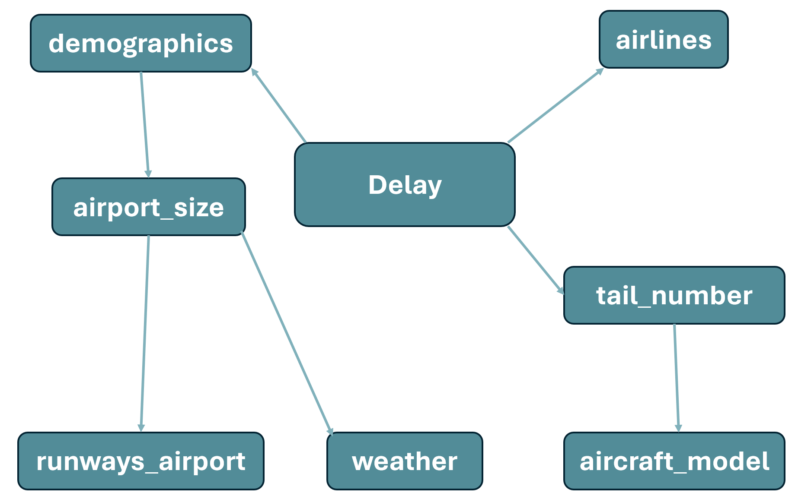
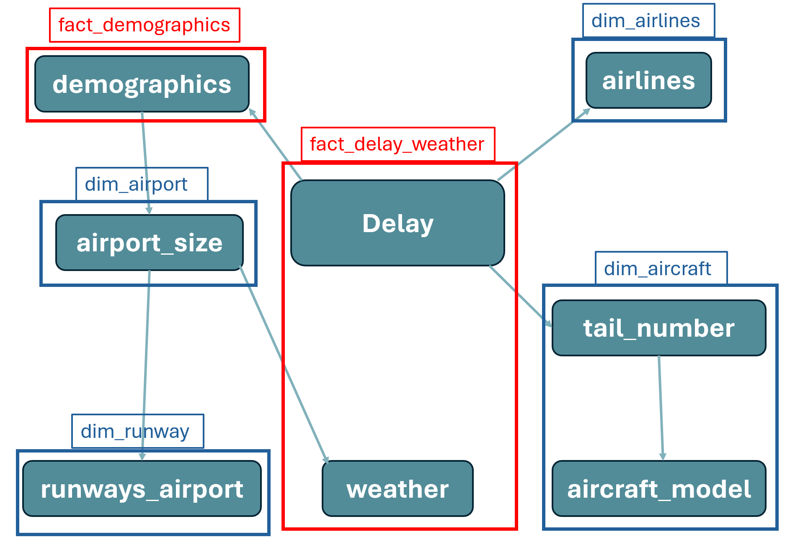
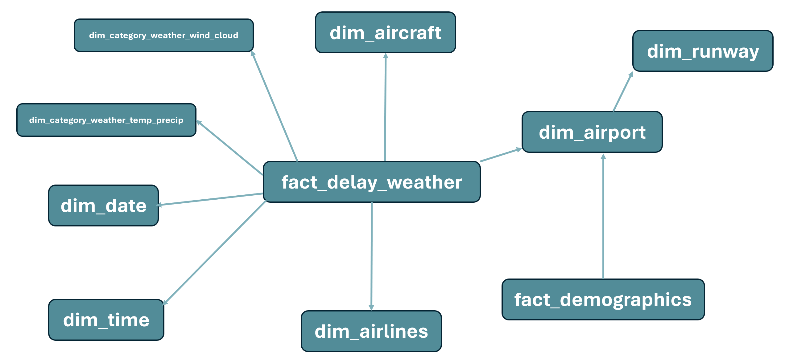
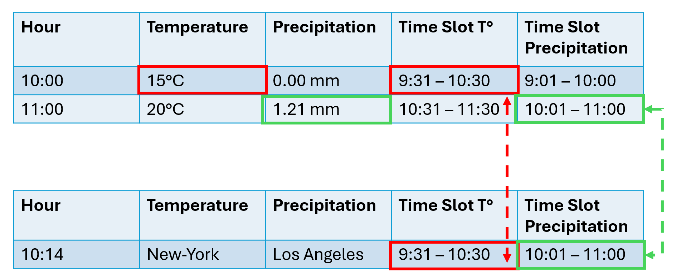

# ✈️ Analysis of U.S. Domestic Flight Delays (2019–2025)

## Repository Structure

```
flight-delays/
├── README.md        Project documentation
├── scripts/         Python notebook and SQL scripts of the ETL pipeline
├── images/          Screenshots and diagrams used in this README
└── dashboard/       Power BI dashboard
```

## Introduction

This project analyses U.S. domestic flight departure delays between 2019 and 2025. The aim is to understand which factors influence departure delays. To do so, I examine delays from several angles (airport size, demographics, weather, etc.).

The analysis covers flights departing from 15 airports, selected to provide coverage across the United States and to include airports of different sizes, defined by the number of enplanements recorded in 2024:

- **5 large (L) airports:** over 10M enplanements
- **5 medium (M) airports:** 2.4M – 10M enplanements
- **5 small (S) airports:** 0.5M – 2.4M enplanements

Delays are classified into three categories:

- **On-time flights:** delay < 15 min (US DOT definition)
- **Moderate delay:** 15 min ≤ delay ≤ 60 min
- **Severe delay:** delay > 60 min

In total, I analyse more than 10M flights departing from 15 airports over a 6-year period.

## Dashboard


<!-- Vidéo 2.mp4 : glisser-déposer ici dans l'éditeur GitHub -->


<!-- Vidéo 5.mp4 : glisser-déposer ici dans l'éditeur GitHub -->


<!-- Vidéo 12.mp4 : glisser-déposer ici dans l'éditeur GitHub -->

<!-- Vidéo 13.mp4 : glisser-déposer ici dans l'éditeur GitHub -->


## Key Results

**Factors that influence delays**

- **Weather:** Extremely low temperatures, high precipitation and high wind speeds are correlated with delays. Wind speeds above 70 km/h lead to the cancellation of all flights. Cloud cover has no impact on delays.
- **Temporality:** Year, day of the week, month and time of day all have an impact on delays.
- **Aircraft rotation:** Over the course of a day, delays tend to accumulate along an aircraft's successive flights.

**Factors with no observed correlation**

- **Airport size:** No correlation between delays and airport size.
- **Traffic:** No correlation between delays and total traffic (number of flights between 2019 and 2025).
- **Demographics:** Population, median household income and the share of bachelor's degree holders are not correlated with delays.


## Data Sources

I used 6 data sources, combining flight, airport, weather and demographic data from public U.S. providers.

| Data | Source | Description |
|---|---|---|
| **Delay** | [Bureau of Transportation Statistics](https://transtats.bts.gov) | Flight departure delay records, including scheduled and actual departure times for each flight, plus cancelled and diverted flight codes. |
| **Weather** | [Open-Meteo API](https://open-meteo.com) | Historical hourly weather data (temperature, precipitation, wind, cloud cover) for each airport, used to assess the impact of weather on delays. |
| **Airport size (2024)** | [Federal Aviation Administration](https://www.faa.gov) | Enplanement figures used to classify the 15 airports into Large, Medium and Small categories. The data is from 2024 and I assumed it remained representative across the 6-year period. |
| **Tail number & aircraft model** | [Federal Aviation Administration](https://www.faa.gov) | Aircraft registration data used to link each flight to its aircraft model. |
| **Runways** | [Bureau of Transportation Statistics](https://geodata.bts.gov) | Runway data for each airport, providing infrastructure context. |
| **Demographics (2022)** | [U.S. Census Bureau API](https://www.census.gov) | Population and socioeconomic data for the metropolitan area of each airport, used to explore whether demographics correlate with delay patterns. The data is from 2022 and I assumed it remained representative across the 6-year period. |

## ETL Pipeline

To obtain these results, I built an ETL pipeline based on the **medallion architecture**:

- **Bronze (staging):** all sources are exported to a SQL Server database. This first database contains the raw data, with a few minor changes.
- **Silver:** the data from Bronze is cleaned and loaded into a second database.
- **Gold:** the third database contains the star schema built with dimensional modeling, using only the data needed for the analysis.


### Bronze (Staging)

This layer consists of loading the data into the Bronze database in SQL Server. I used Python for this step because it made it easier to centralize data from the different sources. The same general steps were applied to the six sources:

1. **Source ingestion**
   I imported the six sources from their original formats (CSV, Excel and TXT) using the Pandas library. For the weather and demographics data, I retrieved the data through API calls.
2. **Data type adjustments**
   I changed column data types when necessary, for example converting numerical values stored as strings into numerical types.
3. **Initial data transformations**
   I applied some transformations required for the analysis:
   - Kept relevant columns when necessary
   - Added derived columns, such as converting distance from miles to kilometers
   - Kept only relevant records, such as data corresponding to the 15 selected airports
4. **Loading into SQL Server**
   I exported the data from my notebook to SQL Server using the SQLAlchemy library, which established the connection between the Python environment and SQL Server and loaded the resulting datasets into the Bronze layer.

From this point, I worked with SQL Server Management Studio (SSMS) to define the primary and foreign keys and establish relationships between the tables.

### Dimensional Modeling

After establishing the relationships between the tables, I obtained a data model diagram. From it, I designed the dimension and fact tables that make up the star schema.





- The `airport_size`, `runways_airport` and `airlines` tables are used as 3 separate dimensions.
- One dimension was created by merging the `tail_number` and `aircraft_model` tables.
- The `demographics` table is a fact table, while another fact table was created by merging the `delay` and `weather` tables.
- I also added separate dimensions for **date** and **time**.
- Finally, I created two additional dimensions from the weather data: `dim_category_weather_temp_precip` and `dim_category_weather_wind_cloud`. They make it possible to analyse delays in relation to categories of temperature, precipitation, wind, cloud cover, etc., and to investigate delays based on combinations of several weather conditions, such as temperature and precipitation.

I could not create a single dimension containing all possible combinations because the number of theoretical combinations would have been too large. Splitting these categories into two dimensions made it possible to analyse the relationships between delays and combinations of weather conditions while keeping the model manageable.

My final star schema looks like this:



### Silver

The Silver layer is built from the Bronze layer. This step of the ETL consists of keeping the useful columns and cleaning the data using SQL.

My data was almost entirely clean, except for the `aircraft_model` table. For example, some manufacturers such as AIRBUS or EMBRAER appeared under different names.

The biggest task in this layer was preparing the merge between the `delay` and `weather` tables. These tables have different granularities (hourly for `weather`, minute-level for `delay`), so I could not merge them directly on date and time. To solve this, I created two time slots: one during which the temperature measurement is considered valid, and one for the precipitation measurement.

The reason is that temperature is recorded at a specific moment, whereas precipitation is the total amount recorded over the previous hour. For example, it makes no sense to assign a temperature recorded at 10:00 to a flight departing at 10:45. Instead, the temperature recorded at 11:00 is assigned to it.

I also added these two time-slot columns to the `delay` table for each scheduled departure time. The merge can then be carried out on these two columns, in addition to the date column (see Gold layer).



The data was loaded into the Silver database using SSMS with the following code:

```sql
SELECT -- useful columns --
INTO -- table name in Silver database --
FROM -- table name in Bronze database --
```

This code automatically creates the tables in the Silver database. I then defined the same primary and foreign keys as in the Bronze layer to establish relationships between the tables.

### Gold

The Gold layer is built from the Silver layer. This step consists of performing the final transformations and merges to reproduce the star schema.

First, I created all the tables in the Gold database in SQL Server and defined the primary and foreign keys. I then made the final adjustments I realised were needed at the last minute.

The biggest task in this layer was creating the dimensions that were not present in the Silver layer: `dim_date`, `dim_time`, `dim_category_weather_temp_precip` and `dim_category_weather_wind_cloud`.

For `dim_category_weather_temp_precip`, I created one view for precipitation categories and another for temperature categories:

- **Temperature:** values grouped into 10-degree intervals.
- **Precipitation:** values divided using a base-2 logarithmic scale. Beyond the 90th percentile the median becomes non-zero, so a linear division would not make sense (0.1 mm of precipitation is meaningfully different from 1 or 2 mm).

These intervals were created with the `CASE` statement. `dim_category_weather_temp_precip` was then built by cross-joining these two views, to obtain all combinations of temperature categories, precipitation categories and precipitation types. The same approach applies to `dim_category_weather_wind_cloud`.

For every table in the star schema, I created a view to construct it before loading it into the Gold table with the following code:

```sql
INSERT INTO dim_table
SELECT *
FROM view_dim_table;
```

To build the `fact_delay_weather` table, I used a CTE. I needed to compute the weather category classes (temperature, precipitation, wind, cloud cover) for each row, in order to join them against the corresponding dimension tables and retrieve the matching category ID, as the fact table should only store these IDs and not the category labels. The CTE allowed me to compute the classes as an intermediate step, perform the join, and insert only the resulting category IDs into `fact_delay_weather`.

## Limitations & Next Steps

**Limitations**

- The analysis covers only 15 airports, which limits how far the conclusions can be generalised to all U.S. airports.
- Airport size (2024) and demographics (2022) data were assumed to be representative over the 2019-2025 period.

**Next steps**

- Extend the analysis to a larger sample of airports, including airports exposed to extreme weather conditions.
- Study the impact of COVID-19 on delays.
- Build a machine learning model to measure the feature importance of the factors influencing delays.


